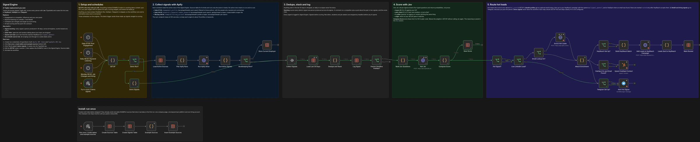
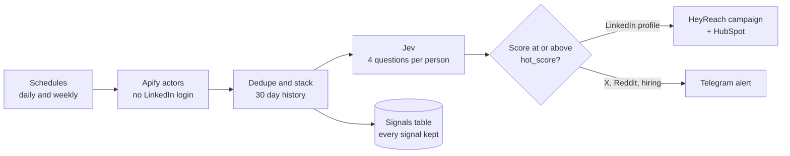
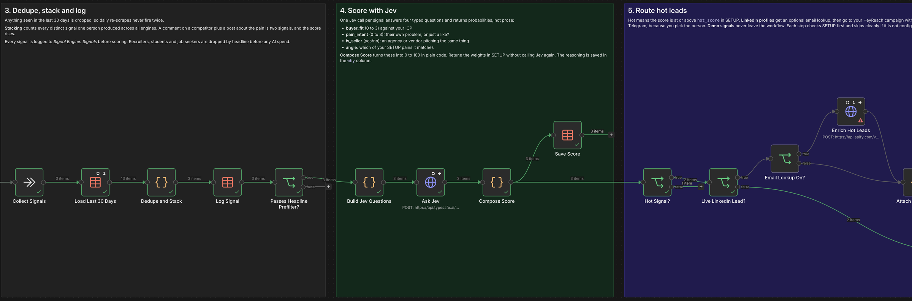

# Trigify alternative for n8n

**Apify finds the buying signals. Jev scores the person. HeyReach gets the hot ones.**

Trigify is shutting down after the HubSpot acquisition. Most accounts close on 22 October 2026 and nothing migrates. This is one n8n workflow that covers the same ground, runs in your own instance and keeps every signal in a table you own.

## What it does

Every morning it looks for people showing intent, decides who is worth talking to, and hands those people to your outreach.

| Trigify feature | How this workflow does it |
|---|---|
| Who engages with competitor, creator or your own posts | Reactors and commenters on posts from profiles and company pages you choose |
| Social listening | Posts about your buyer's pain on LinkedIn, X and Reddit |
| Job change and hiring triggers | Past champions changing company, target accounts hiring sales roles |
| TrigIQ lead scoring | Jev answers four questions per person and plain code turns them into a 0 to 100 score |
| Push to HeyReach / HubSpot | Hot LinkedIn leads go into your HeyReach campaign, HubSpot when an email is found, Telegram for the rest |

Three things worth knowing about how it decides:

- **Signals stack per person.** A comment on a competitor's post and, a week later, a post about the same problem count as two signals from one person. One like on a viral post counts as one, and it scores low.
- **Sellers get filtered.** The people posting most about "reps hate the CRM" are often agencies selling the fix. Jev flags them and their score is cut.
- **Openers come from your words, not the model.** You write one opener per pain you solve. Jev picks which pain the person was talking about, and your line goes to HeyReach as `{signal_opener}`. If nothing matches, it stays empty instead of making something up.

## How it works

**What Jev is asked for every signal**

| Question | Type | What it tells you |
|---|---|---|
| `buyer_fit` | Score 0 to 3 | Does the person match your ICP, judged from their headline |
| `pain_intent` | Score 0 to 3 | Are they describing their own problem, or just reacting |
| `is_seller` | Yes / no | Are they selling the same thing you sell |
| `angle` | Choice | Which of your pains the signal is about |

The score is built in a Code node you can read: weights from SETUP, anyone who isn't a buyer is capped at 40, sellers are cut to a fifth. Change a weight and re-score without calling Jev again. The breakdown is saved per lead in the `why` column.

## What the demo looks like

Three made-up signals, one click, no Apify needed. This is a real run straight after importing the file:

| Demo person | What they wrote | Score |
|---|---|---|
| VP Sales, 40-person solar company | "my reps spend two hours a day logging calls in the CRM" | 78, hot, CRM admin opener |
| CEO, 12-partner law firm | "half our inbound consults never hear back within a day" | 88, hot, follow-up opener |
| Founder of a CRM agency | "5 reasons your reps hate your CRM, DM me" | 1, filtered as a seller |

Scores move by a point or two between runs. Demo signals never leave the workflow.

## Setup, about 15 minutes

**You need:** n8n (cloud or self-hosted, with Data tables), an [Apify](https://apify.com) account and a [TypeSafe](https://typesafe.ai) API key for Jev. HeyReach, HubSpot and Telegram are optional and can be added later.

1. **Import.** In n8n: *Workflows → Import from URL* and paste
   `https://raw.githubusercontent.com/tonimedic/trigify-alternative-n8n/main/signal-engine.n8n.json`
2. **Add two credentials** of type *Bearer Auth*:
   - `TypeSafe API key` → select it on **Ask Jev**
   - `Apify API token` (Apify console → Settings → API & Integrations) → select it on **Run Apify Actor** and **Enrich Hot Leads**
3. **Run once: create tables and example sources.** Creates the two data tables and fills in example sources that return real data on the first run.
4. **Try it: score 3 demo signals.** Needs only the TypeSafe key. You should get two hot leads and one seller filtered out.
5. **Edit the SETUP node** (section 1 on the canvas). It's the only node you touch. Every block marked `EXAMPLE` works as-is, so replace it at your own pace:
   - `icp`: who you sell to, in plain words
   - `angles`: the pains you solve, with the opener you would send for each
   - `weights` and `hot_score`
   - `heyreach_campaign_id`, `heyreach_sender_account_id`, `hubspot_enabled`, `enrich_emails`, `telegram_chat_id`. Anything left empty is skipped.
6. **Replace the example rows** in the *Signal Engine: Sources* table with your own, then activate.

### The Sources table

One row per thing to watch. Set `active` to false to pause a row without deleting it.

| `kind` | `target` | Runs |
|---|---|---|
| `engagement_profile` | A LinkedIn profile or company page URL | Daily 07:00 |
| `keyword` | A LinkedIn search phrase | Daily 06:00 |
| `x_keyword` | An X search phrase (X search syntax works) | Daily 06:00 |
| `reddit_keyword` | A Reddit search phrase | Daily 06:00 |
| `champion` | A past buyer's LinkedIn profile URL | Monday 08:00 |
| `hiring_account` | A company page URL; put role titles in `notes`, comma separated | Monday 08:00 |

Write keywords the way a buyer complains, not as a category. `CRM` finds vendors selling CRMs. `reps won't update the CRM` finds the people with the problem.

## What it costs

- **Apify** bills per result. The harvestapi LinkedIn actors list roughly $1.50 to $2 per 1,000 posts, reactions or comments. Email lookup costs more, so it's off by default and only runs on hot leads when you switch it on.
- **Jev** is one call per new signal that passes the headline filter, about 1,100 input tokens each.
- **Your LinkedIn accounts** are never logged in anywhere, so no seat is at risk from the scraping.

## Status and limits

- **Tested:** import from this repo, table setup, and the full demo path with real Jev calls (dedupe, stacking, scoring, routing decisions, table writes).
- **Built but not yet run against live Apify data:** the three collectors. They follow each actor's published input schema, and the normalizer is written defensively, but the first real run is where field-name surprises show up. If one breaks for you, open an issue with the failing node's output.
- Apify's sync endpoint stops at 300 seconds, so keep each engine to about 10 tracked profiles or keywords, or duplicate the workflow.
- X, Reddit and hiring signals go to Telegram only, not HeyReach, because you still pick the right person.
- Demo runs are logged to the Signals table so you can see it fill. Delete those rows whenever you like.

## Actors used

`harvestapi/linkedin-post-search` · `harvestapi/linkedin-profile-scraper` · `harvestapi/linkedin-job-search` · `apidojo/tweet-scraper` · `trudax/reddit-scraper-lite`

The node code is in [`code/`](code) if you want to read it before importing.

---

Built by Toni Medic at [Salestruct](https://salestruct.com). Questions or a broken collector: open an issue.
